# Jukie — Features

Jukie brings Apple Music to the legacy Palm and HP webOS ecosystem — including the HP TouchPad (webOS 3.x) and classic phones like the Palm Pre 2, Veer, and Pre 3 (webOS 2.x) — more than a decade after these devices stopped receiving updates.

From full library synchronization and catalog search to time-synchronized lyrics and ambient TouchStone Exhibition Mode, Jukie delivers a native, first-class Apple Music experience across two generations of webOS hardware.

---

## HP TouchPad (webOS 3.x / Enyo)

The tablet experience is built on Enyo, designed specifically for the TouchPad's 1024×768 display.

### Your Whole Library, Synced

Songs, artists, and albums from your Apple Music library sync directly to the device. The classic fast A-Z scrubber (`AlphaPicker`) lets you glide through a large library in a single swipe.

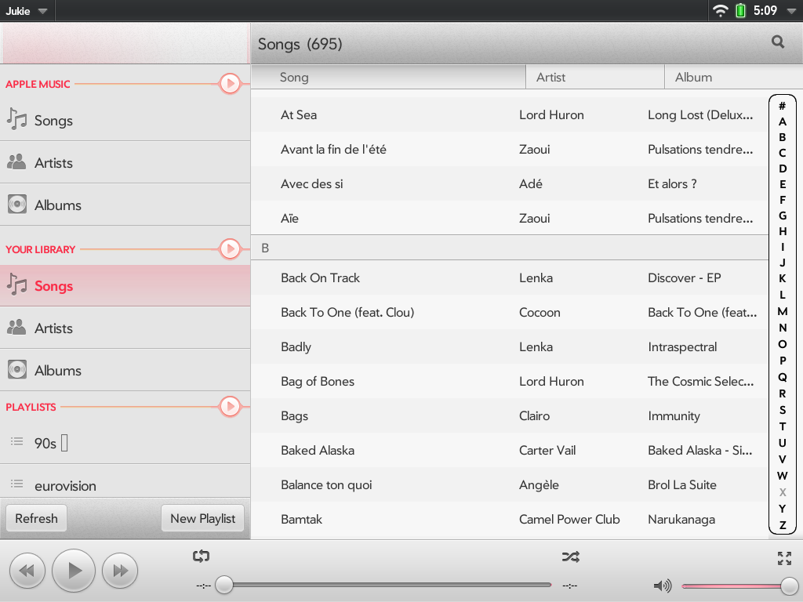
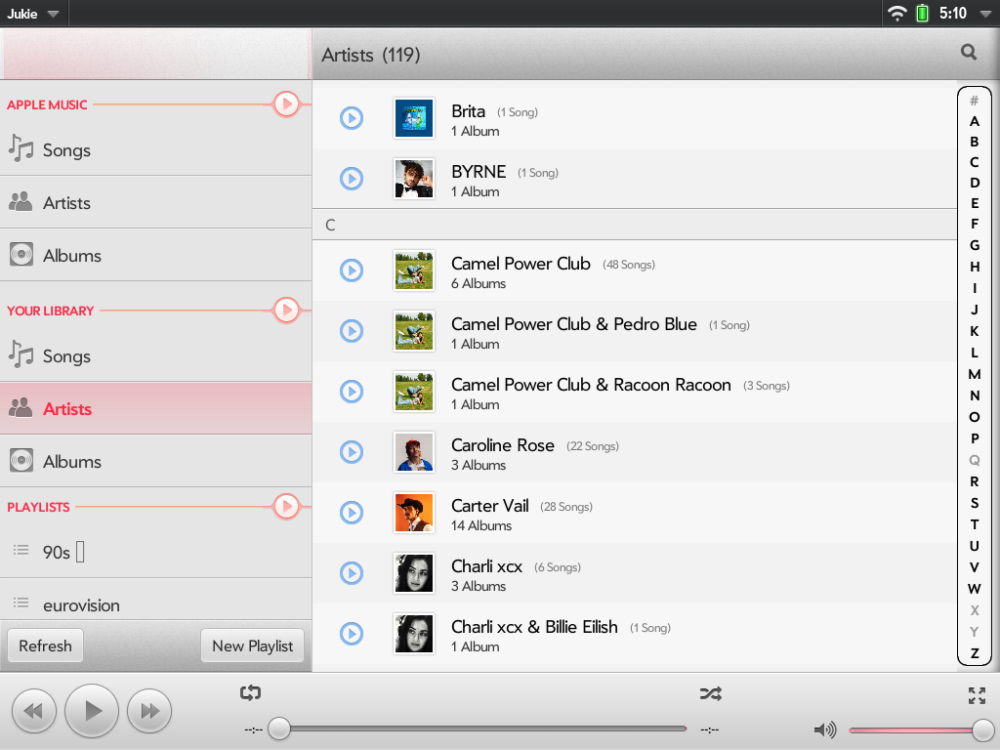
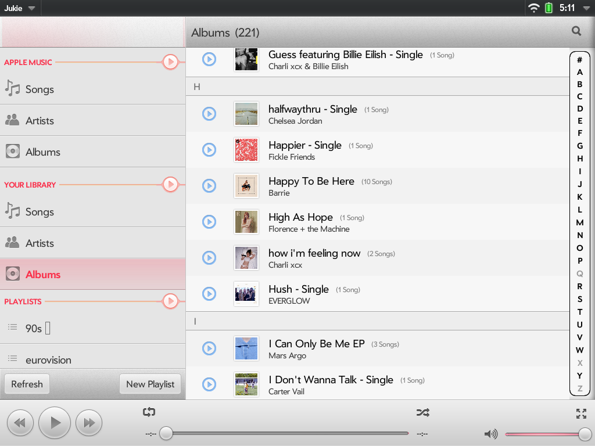

Tapping into an artist or album displays a full track listing with real-time active track indication and instant playback upon tapping.

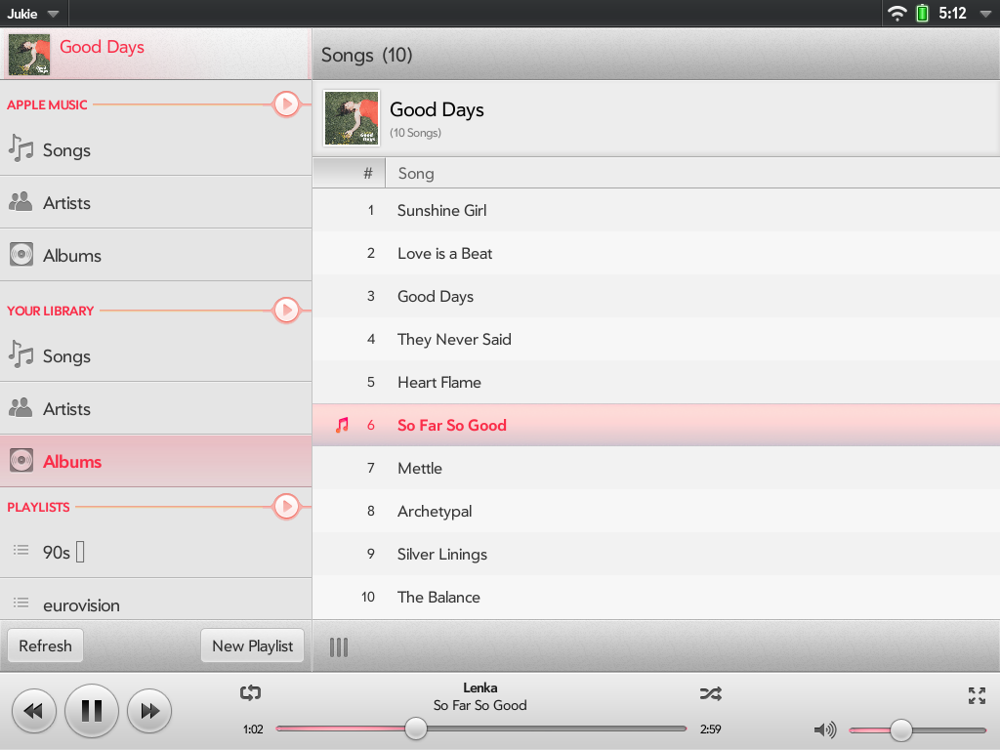

### The Full Apple Music Catalog

Search is not limited to your personal library — browse the entire Apple Music global catalog. Search for any artist, view their full discography and albums, and stream full tracks.

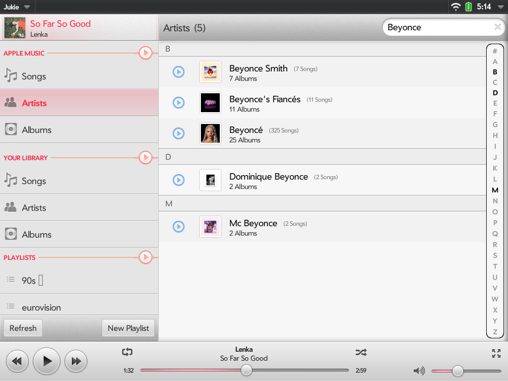
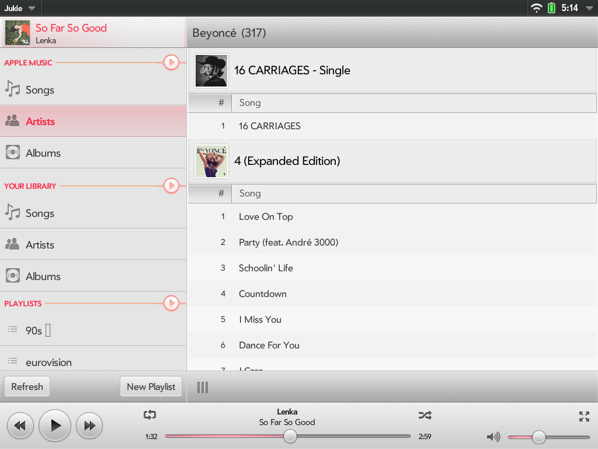

### Now Playing & CoverFlow

Enjoy full-track playback with real seeking, pause, volume control, and an immersive full-screen swipeable album art CoverFlow view.

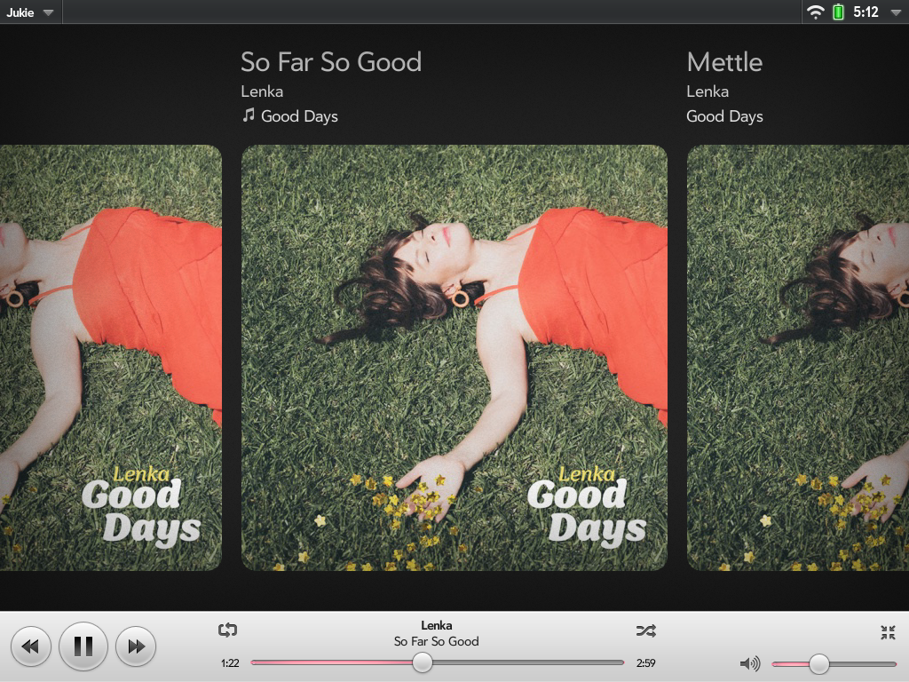

### Time-Synchronized Lyrics (CoverFlow Split View)

In CoverFlow, tap the **Lyrics** option in the top webOS status bar App Menu to enter a dedicated iPad-style 50/50 split view:
- **Left Column**: High-resolution album artwork, responsive title/artist/album metadata, and a quick tap-to-pause/play toggle.
- **Right Column**: Real-time synchronized lyrics parsed directly from TTML, highlighting active lines in Apple Music accent red and smoothly scrolling into view as the song progresses.
- **Interactive Tap-to-Seek**: Tap any timestamped lyric line to jump playback directly to that moment.
- **Credits & Fallbacks**: Formatted songwriter credits at the end, with clean empty states when lyrics are unavailable.

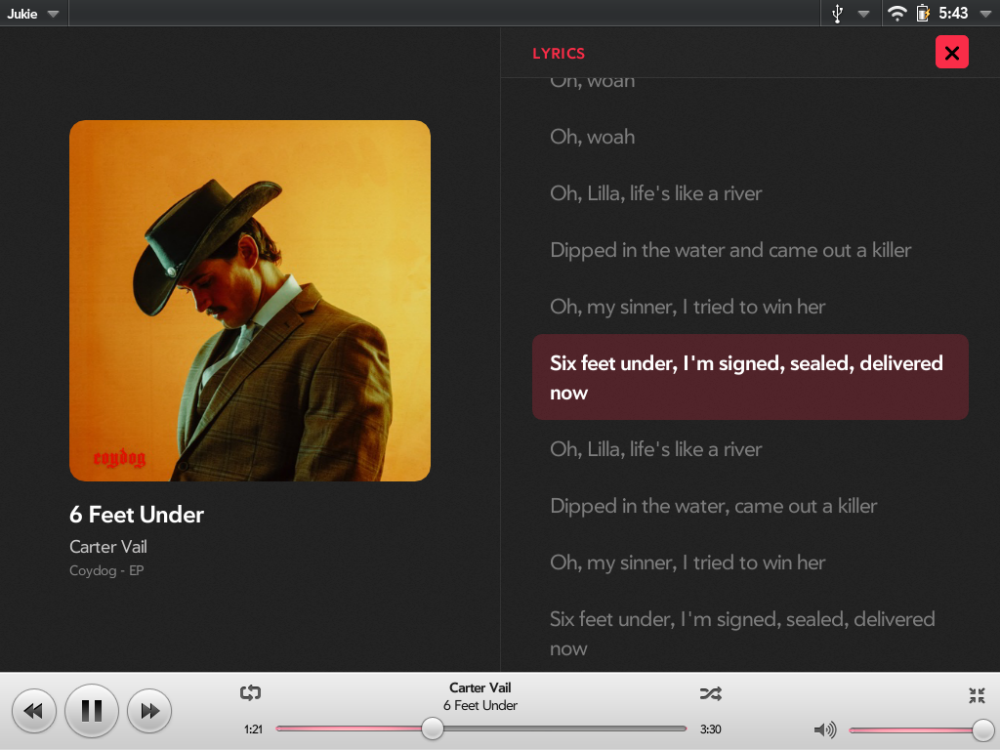

### TouchStone Exhibition Mode

When docked on an HP TouchStone (or launched via the App Menu), the TouchPad transforms into an ambient music dock:
- Full-bleed ambient album artwork and large time display.
- Floating semi-transparent lyrics panel with auto-scrolling and tap-to-seek.
- Tap track info to toggle lyrics visibility on or off.

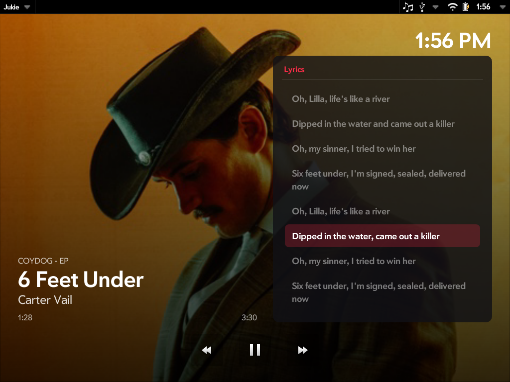

### Native webOS Tablet Citizen

Jukie hooks directly into the core webOS system features:
- **Just Type**: Type a song or artist on the Home screen to jump straight to library results without opening the app first.
- **Lock Screen Controls**: Skip tracks, play/pause, and view current track info without unlocking the TouchPad.
- **Dashboard & Status Bar**: Native status bar dropdown menu and Now Playing dashboard cards that run smoothly alongside multitasking apps.

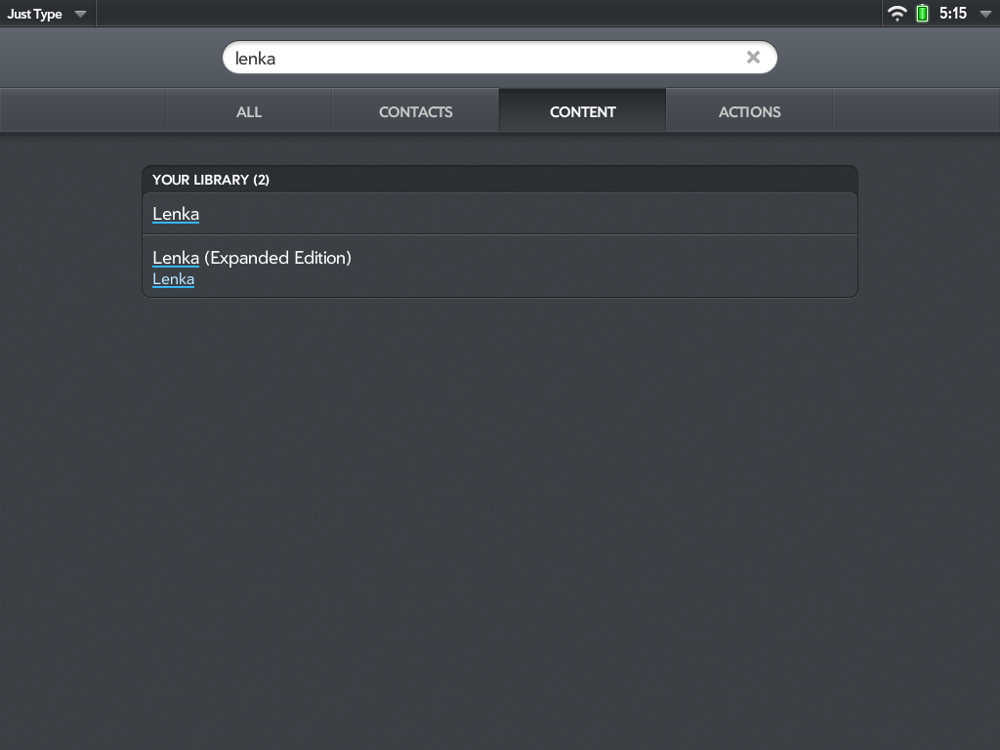
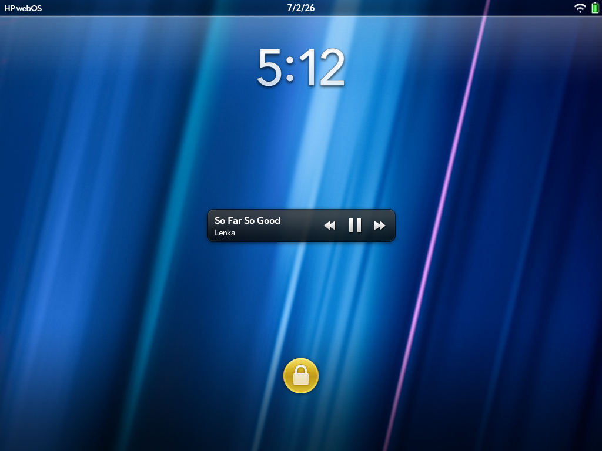
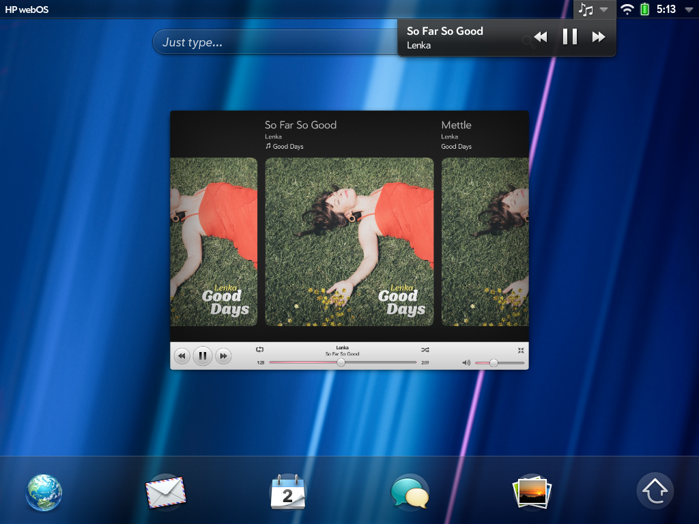

---

## webOS 2.x Phones (Mojo — Pre 2, Veer, Pre 3)

Jukie includes a ground-up Mojo port tailored to portrait phone screens, offering the identical feature set and DRM-backed full playback on webOS 2.x devices.

### Native Phone Interface & Navigation

A clean, responsive Mojo interface with intuitive touch lists, quick categorization, and instant library sync:

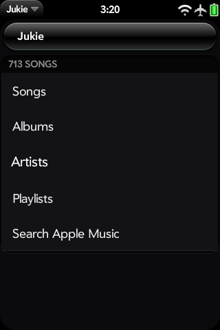
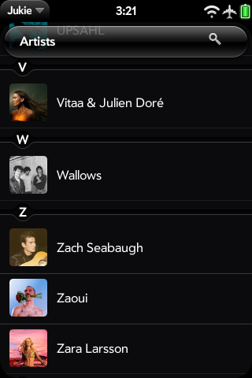
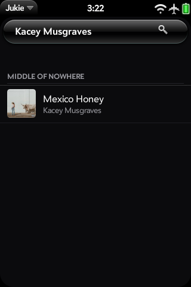

### Phone Catalog Search

Full catalog search with instant access to top songs, albums, and discographies directly on your phone:

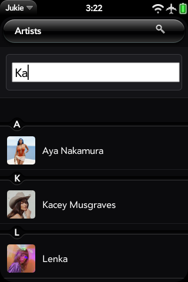

### Phone Now Playing

A full-featured Now Playing scene featuring album cover art, transport controls, draggable seek bar, and live track info:

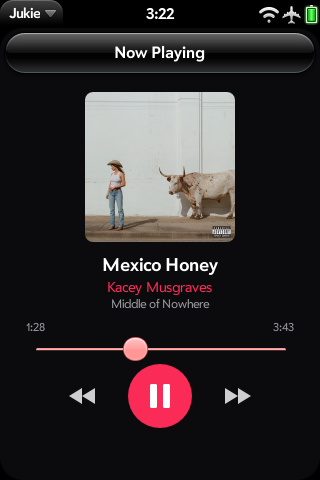

### Time-Synchronized Lyrics (Now Playing Flip View)

Read synchronized lyrics right on your phone:
- Tap the **Lyrics** button or tap the album artwork directly to flip seamlessly between album cover and scrolling lyrics.
- Active lines illuminate in Apple Music accent red and track vocal timing in real-time.
- Tap any line to seek immediately to that verse or chorus.
- State persists across tracks and app sessions.

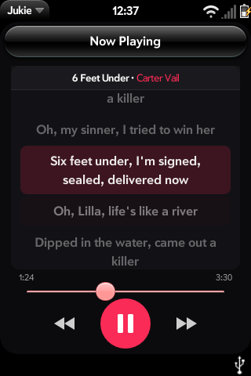

### TouchStone Dock on Phones

Dock your Pre 2 or Veer on a TouchStone dock to activate the full-screen phone Exhibition Mode with docked time-synced lyrics and playback controls:

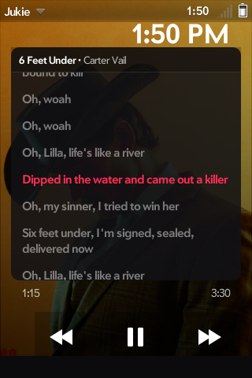

### Just Type on Phones

Search your music library directly from the phone's card view using Just Type:

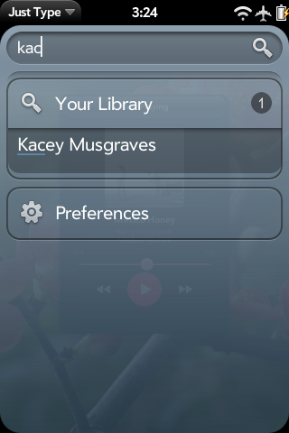
